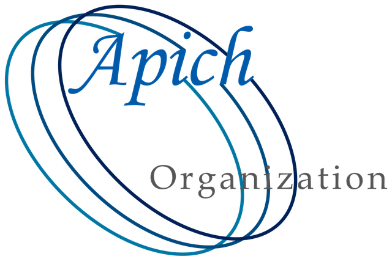

<picture>
  <source media="(prefers-color-scheme: dark)" srcset="./apich-logo-dark.png">
  
</picture>

**Open infrastructure for scientific computing and a more resilient cyberspace.**

We maintain the runtimes, compilers, serialization formats and numerical engines that scientific software is built on — released in the open, and checked against a published security baseline before each release.

[apich.org](https://apich.org/) · [Projects](https://apich.org/projects/) · [Research](https://apich.org/research/) · [Security](https://apich.org/security/) · [Blog](https://apich.org/blog/) · [Sponsor](https://opencollective.com/apich-organization)

---

## Projects

| Project | What it does | Links |
| --- | --- | --- |
| **dtact** | Stackful coroutine runtime for heterogeneous orchestration and hardware-level control | [repo](https://github.com/Apich-Organization/dtact) · [site](https://apich.org/projects/dtact/) · [DOI](https://doi.org/10.5281/zenodo.20002105) |
| **ensia** | LLVM obfuscator: fifteen passes in a twelve-stage cascade, with no central interpreter to devirtualize | [repo](https://github.com/Apich-Organization/ensia) · [site](https://apich.org/projects/ensia/) · [DOI](https://doi.org/10.5281/zenodo.20149843) |
| **bincode-next** | Binary serialization for Rust, with zero-copy decoding | [repo](https://github.com/Apich-Organization/bincode) · [site](https://apich.org/projects/bincode/) · [DOI](https://doi.org/10.6084/m9.figshare.31410402) |
| **rssn** | Computer algebra and numerical kernels: symbolic rewriting on an e-graph, dimensions in every term | [repo](https://github.com/Apich-Organization/rssn) · [site](https://apich.org/projects/rssn/) · [DOI](https://doi.org/10.6084/m9.figshare.31044715) |
| **cargo-slide** | Code-driven presentations: Typst typesetting with a native Rust runtime | [repo](https://github.com/Apich-Organization/cargo-slide) · [site](https://apich.org/projects/cargo-slide/) |
| **virtue** | A small helper for writing proc-macro derives, with no required dependencies | [repo](https://github.com/Apich-Organization/virtue) · [site](https://apich.org/projects/virtue/) |
| **aevia** | A functional language that rejects dimensionally inconsistent expressions before the program runs | [repo](https://github.com/Apich-Organization/aevia) · [site](https://apich.org/projects/aevia/) |

Versions, feature detail and install instructions live on the site, which is refreshed from each project's release source. Work in the lab is not listed here until it has a release.

Archived copies: [dtact](https://archive.softwareheritage.org/swh:1:dir:62bd3423ead4bec1ae8dea921046e96a7e4a1ebc) · [ensia](https://archive.softwareheritage.org/swh:1:dir:8e603e7611495a327313e6ce0da65b059f168209)

## Teams

Four teams, one engineering standard — research proposes, engineering builds, security reviews, consultancy keeps it grounded in production.

- **[Science & Research Team](https://apich.org/research/)** — physics-informed neural networks, AI for science, high-performance computing. Preprints on OSF and Zenodo.
- **[Open Source Development Team](https://apich.org/projects/)** — the projects above, plus the tooling around them.
- **[Security Team](https://apich.org/security/)** — vulnerability disclosure, the hardening baseline, and review before every release.
- **Consultancy Team** — engineering work for outside organizations, under the same standards.

## Security

Please report vulnerabilities privately; a public issue tells everyone about the problem before a fix exists.

- **security@apich.org** — [PGP key](https://apich.org/assets/security-pgp.asc), fingerprint `BB45 2767 B5A4 BDFD B606 2D83 1373 B738 BCD8 A75D`
- [Security policy](https://apich.org/security/) · [RFC 9116 contact file](https://apich.org/.well-known/security.txt)
- We acknowledge every report and aim to respond within seven days.

The [YGS-2026 report](https://ygs-2026.apich.org/) documents a spyware family we analysed; [advisory-db](https://github.com/Apich-Organization/advisory-db) carries the advisories we publish for Rust crates.

## Community

- **Zulip** — https://apich.zulipchat.com/ (recommended; migration in progress)
- **Discord** — https://discord.gg/D5e2czMTT9
- **Status** — https://status.apich.org/ · **Controlled releases** — https://obsign.apich.org/

Thanks to Kandra Labs, Inc. for sponsoring us through the Zulip Cloud Standard Plan.

## For members

- **Workspace, SSO and Git** — https://workspace.apich.org/ (coming soon)
- **Vault** — https://vault.apich.org/ · **Resources** — https://resources.apich.org/
- **Lark workspace ID** — `LED1Z8OYX8O`
- Personal sites live at `https://<github-username>.apich.org`; personal blogs at `https://<github-username>.blog.apich.org`.

## Contact

| Address | For |
| --- | --- |
| [info@apich.org](mailto:info@apich.org) | general enquiries, collaboration |
| [security@apich.org](mailto:security@apich.org) | vulnerabilities, security questions |
| [research@apich.org](mailto:research@apich.org) | the Science & Research Team |
| [admin@apich.org](mailto:admin@apich.org) | administration, code of conduct |

Site text is CC BY 4.0; code is MIT OR Apache-2.0. Each project states its own license on its page.
